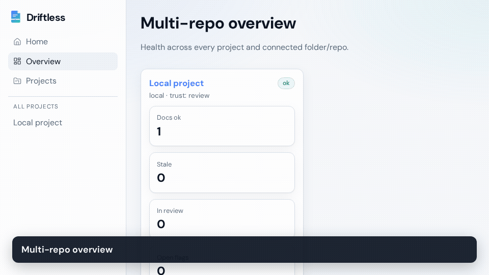
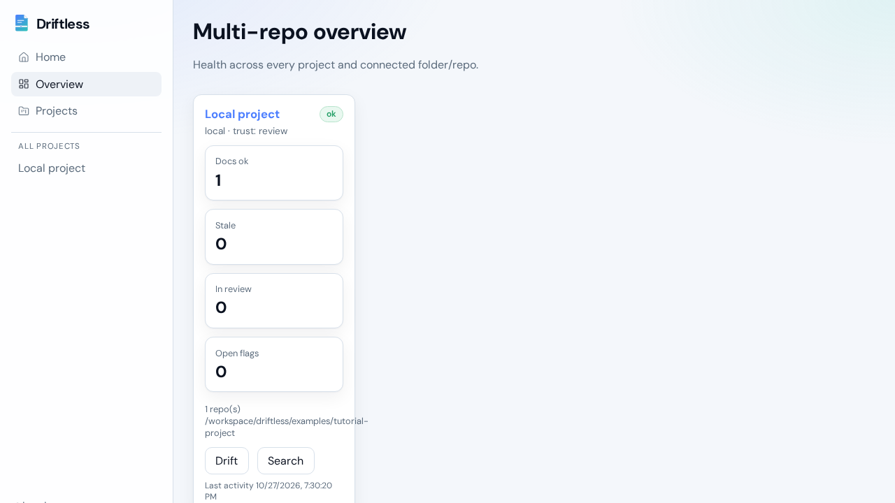
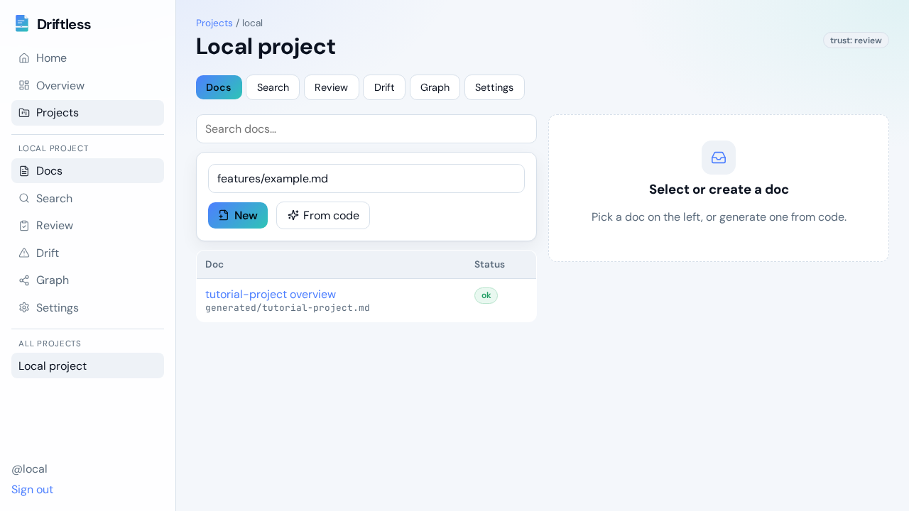
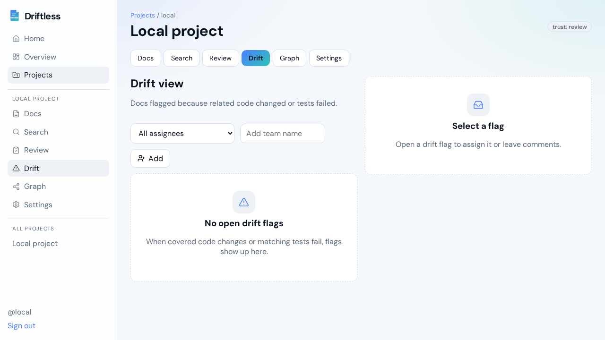
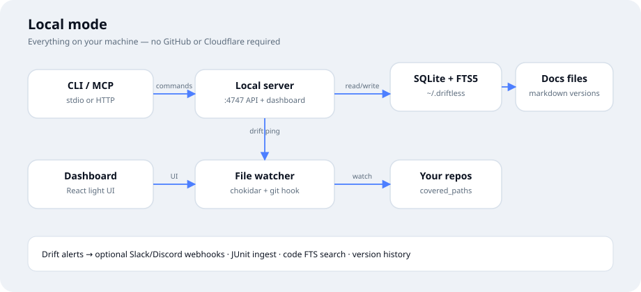

<p align="center">
  
</p>

<p align="center">
  <a href="LICENSE"></a>
  <a href="https://github.com/SahinurDEV/driftless/actions"></a>
  <a href="https://driftless.sahinur.dev"></a>
  <a href="https://docs.driftless.sahinur.dev"></a>
</p>

<p align="center"><strong>Self-hosted living docs for teams</strong> — markdown stays in sync with code across repos, with MCP for AI agents. Runs on Cloudflare — or fully locally with zero cloud deps.</p>

<p align="center">
  
</p>

<p align="center">
  
  
  
</p>

## Why

When code moves fast (especially with AI), docs go stale. Every developer's agent starts from zero. Local single-repo tools help one person; Driftless is the **shared** brain for a whole product spanning backend, web, and mobile.

## Features (first release)

- **Workspace → projects → repos** — one project treats several GitHub repos as one system
- **Docs live in Driftless** (R2 + version history), not in code repos
- **Drift detection without AI** — path + name matching, cross-repo via FTS5, optional Graft links
- **Trust modes** — `review` / `auto` / `trust` (API key permissions always win)
- **Optimistic concurrency** — edits carry `base_version`; conflicts return a re-read error
- **Section-level patches** for agents (outline → section → patch)
- **Remote MCP server** with per-user API keys (`dl_…`)
- **GitHub OAuth**, project roles (owner / editor / viewer)
- **GitHub webhooks → Queues** for background drift checks
- **Share links** (expiring, read-only) and **markdown export**
- **Optional** Vectorize + Workers AI embeddings (debounced)
- **React dashboard** — docs, search, review queue, drift view, graph view, settings


## Run locally (no GitHub, no cloud)

Use the same codebase without Cloudflare, GitHub OAuth, or webhooks:

```bash
npm install
npm run build:dashboard
npx tsx src/local/cli.ts init
npx tsx src/local/cli.ts repo add .
npx tsx src/local/cli.ts serve
```

Open http://127.0.0.1:4747 — file watching flags drift; MCP is at `/mcp` and via `driftless mcp` (stdio).

Full walkthrough: **[docs/LOCAL-GUIDE.md](docs/LOCAL-GUIDE.md)** (install, docs frontmatter, drift, review, Cursor/Claude MCP, export, troubleshooting).

```bash
# Cursor / Claude Desktop (stdio)
npx tsx src/local/cli.ts mcp --token dl_…
```

```json
{
  "mcpServers": {
    "driftless": {
      "command": "npx",
      "args": ["tsx", "/path/to/driftless/src/local/cli.ts", "mcp", "--token", "dl_…"]
    }
  }
}
```

HTTP MCP while `serve` is running: `http://127.0.0.1:4747/mcp` with `Authorization: Bearer dl_…`.

> npm publish may require credentials you do not have — run from a clone (`npx tsx src/local/cli.ts` or `npm link`) or `npx github:SahinurDEV/driftless`.


## Quick start (Wrangler / Cloudflare local)

```bash
npm install
cp .env.example .dev.vars
# Fill GITHUB_CLIENT_ID, GITHUB_CLIENT_SECRET, SESSION_SECRET, WEBHOOK_SECRET

# Create local D1 / apply migrations (wrangler will prompt as needed)
npx wrangler d1 migrations apply driftless --local

npm run build:dashboard
npm run dev
```

Open `http://localhost:8787`. Dashboard assets are served from the Worker via Wrangler assets.

```bash
npm test
npm run typecheck
```

## Deploy to Cloudflare

1. Click **Deploy to Cloudflare** above, or:

```bash
npx wrangler login
npx wrangler d1 create driftless
npx wrangler r2 bucket create driftless-docs
npx wrangler queues create driftless-jobs
# Optional semantic search:
# npx wrangler vectorize create driftless-embeddings --dimensions=768 --metric=cosine
```

2. Put the D1 `database_id` into `wrangler.toml`.
3. Set secrets:

```bash
npx wrangler secret put GITHUB_CLIENT_ID
npx wrangler secret put GITHUB_CLIENT_SECRET
npx wrangler secret put SESSION_SECRET
npx wrangler secret put WEBHOOK_SECRET
# optional:
npx wrangler secret put APP_BASE_URL
```

4. Create a GitHub OAuth App (Authorization callback URL: `https://<your-worker>/oauth/github/callback`).
5. Build and deploy:

```bash
npm install
npm run build:dashboard
npx wrangler d1 migrations apply driftless --remote
npx wrangler deploy
```

6. On each connected repo, add a webhook: `https://<your-worker>/webhook/github` (content type JSON, secret = `WEBHOOK_SECRET`, event: `push`).

### Secrets you must configure

| Secret | Purpose |
|--------|---------|
| `GITHUB_CLIENT_ID` | GitHub OAuth App client id |
| `GITHUB_CLIENT_SECRET` | GitHub OAuth App secret |
| `SESSION_SECRET` | Cookie/session hashing material (long random string) |
| `WEBHOOK_SECRET` | GitHub webhook HMAC secret |
| `APP_BASE_URL` | Optional canonical URL for OAuth redirects |

This repo does **not** create the GitHub OAuth App for you — create it under GitHub → Settings → Developer settings → OAuth Apps.

## MCP

Point any MCP client at:

```
https://<your-worker>/mcp
Authorization: Bearer dl_<your-api-key>
```

Tools: `search_docs`, `list_docs`, `read_doc`, `read_outline`, `read_section`, `recent_changes`, `drift_status`, `edit_section`, `query_code_graph`.

Create keys in the dashboard **Settings** page (or `POST /api/keys`).

### Doc frontmatter

```markdown
---
title: Billing
covered_paths:
  - src/billing/**
  - src/payments/stripe.ts
covered_names:
  - createInvoice
  - POST /api/billing
---
```

## Trust modes

| Mode | Behavior |
|------|----------|
| **review** | Every agent edit goes to the review queue |
| **auto** | Small safe fixes apply; larger rewrites need review |
| **trust** | Agent edits apply immediately (changelog via versions) |

A **read-only** API key can never write, even in Trust mode.

## Architecture




```
Workers  → REST API, MCP, OAuth, webhooks, share links, dashboard
D1       → metadata, roles, hashed API keys, drift flags, FTS5
R2       → every markdown version (+ optional Graft output)
Queues   → drift checks, debounced embeddings
Vectorize / Workers AI → optional semantic search
```

Docs site: [docs.driftless.sahinur.dev](https://docs.driftless.sahinur.dev) · Tutorial: [docs/TUTORIAL.md](docs/TUTORIAL.md)

## Contributor ideas (not built by the maintainer)

These stay optional plugins — good places for contributors:

1. **AI drift judgment** — after path/name flags, ask a model whether the change actually matters (cut false positives). Use the operator's own API key; never required for core.
2. **AI draft updates** — when a doc is flagged, draft a suggested markdown patch into the review queue.
3. **CLI sync** — Dropbox-style local folder sync (`driftless sync ./docs`).
4. **Optional git mirror** — push exported markdown into a docs repo on approve.

## License

MIT © Sahinur